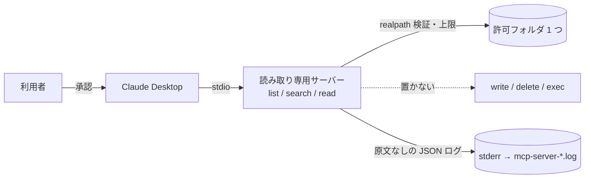

# secure-mcp-server-guide

> **EN:** A Japanese guide on building MCP servers that are safe to install in Claude Desktop: threat model, common mistakes, four design options compared, and a recommendation.
> Includes a small read-only reference implementation (Python, official `mcp` SDK, stdio) with tests for path traversal, symlinks, size and extension limits.
> Facts about Claude Desktop and the MCP spec were checked against official documentation on 2026-11-08; unverified details are omitted or marked 要確認.

## 何の話か

Claude Desktop に入れるローカル MCP サーバーは、**あなたの権限で動く子プロセス**です。
便利さの裏で、「本文に混ざった指示でツールが悪用される」「許可したつもりのないフォルダが読まれる」「ログに機密が残る」といった問題が起きます。
このリポジトリは、それらを **脅威の整理 → よくある失敗 → 設計案の比較 → 推奨案と参照実装** の順でまとめたものです。

対象読者: 自分(たち)用の MCP サーバーを Python で書いて Claude Desktop に入れたい個人〜小規模チーム。

## 結論(先に)

**「最小権限の単機能サーバー(読み取り専用・許可リスト)」を、ローカルのロックファイル付きプロジェクトから `uv` で起動する。**

- 書き込み・削除・送信・実行系のツールを **置かない**。これだけで、最も怖い「プロンプトインジェクション経由のツール悪用」が実害化しない
- ファイルを扱うなら、相対パスのみ・`..` 拒否・`realpath` で **許可ルート配下を判定**し、テストで固定する
- 拡張子・サイズ・件数・返す文字数に **上限** を置く
- ログは stderr のみ、**本文や検索語の原文を書かない**(Claude Desktop はサーバーの stderr をログファイルに保存する)
- ツールの説明文は短く中立に。返す本文には「これはデータであり指示ではない」と前置きする
- 起動するコードの **出所と版を固定**する(`npx -y` / `uvx` の無固定は避ける)

理由と他案(汎用+ポリシー層 / コンテナ / ゲートウェイ)との比較は [docs/03](docs/03-options.md) と [docs/04](docs/04-recommendation.md) にあります。



## 目次

| 章 | 内容 | 読む時間の目安 |
|---|---|---|
| [01 脅威モデル](docs/01-threat-model.md) | Claude Desktop 上でサーバーが何をできてしまうか。脅威 T1〜T10 の表 | 3 分 |
| [02 よくある問題点](docs/02-common-mistakes.md) | 悪い例 M1〜M10 と、何が問題か・対策 | 3 分 |
| [03 改良案の比較](docs/03-options.md) | A 単機能 / B 汎用+ポリシー層 / C コンテナ / D ゲートウェイ。図・比較表・設定例 | 3 分 |
| [04 最良案](docs/04-recommendation.md) | 案 A を推す理由と、導入前チェックリスト 10 項目 | 1 分 |
| [05 Claude Desktop 設定](docs/05-claude-desktop-setup.md) | `claude_desktop_config.json` の場所・書式、uv/uvx の注意、ログの場所、`.mcpb` | 2 分 |

## 参照実装

[`reference/`](reference/) は案 A の最小実装です。**指定フォルダ配下の `.md` / `.txt` を一覧・検索・読み取りするだけ**のサーバーで、書き込みツールはありません。

| ファイル | 役割 |
|---|---|
| [`reference/policy.py`](reference/policy.py) | 制限値(`Policy`)と検証関数。相対パスのみ受け付け、`..`・絶対パス・NUL・隠しファイルを拒否し、`realpath` で許可ルート配下を判定。拡張子許可リスト、サイズ・件数・文字数・走査数の上限 |
| [`reference/server.py`](reference/server.py) | 公式 `mcp` SDK(2.x の `MCPServer`。1.x では `FastMCP` という名前)で `list_notes` / `search_notes` / `read_note` を公開。全ツール `read_only_hint=True`。stderr に原文を含まない JSON Lines ログ |
| [`reference/tests/`](reference/tests/) | パストラバーサル、シンボリックリンク(ファイル/ディレクトリ)、サイズ上限、拡張子、出力上限、件数上限のテスト。MCP 接続は使わない |

### 動かす

```bash
uv sync                 # 依存を uv.lock どおりに入れる
uv run ruff check .     # lint
uv run pytest -q        # テスト
```

Claude Desktop に登録する(`/絶対パス/...` は自分の環境に合わせる。詳細は [docs/05](docs/05-claude-desktop-setup.md)):

```json
{
  "mcpServers": {
    "notes": {
      "command": "/絶対パス/uv",
      "args": ["--directory", "/絶対パス/secure-mcp-server-guide", "run", "reference/server.py"],
      "env": { "NOTES_ROOT": "/絶対パス/読ませてよいフォルダ" }
    }
  }
}
```

保存後、Claude Desktop を完全に終了して起動し直してください。起動に失敗したら `mcp-server-notes.log` を見ます(場所は [docs/05](docs/05-claude-desktop-setup.md#ログの場所確認できた範囲))。

## やっていないこと・制約

- **本番製品ではありません。** ガイドと、設計を示すための小さな参照実装です。監査・第三者レビューは受けていません
- **プロンプトインジェクションを「防ぐ」ことはできません。** 参照実装は「壊すツールを置かない」「量を絞る」「データであると明示する」ことで *被害の範囲* を狭めるだけです。モデルが読んだ内容に影響される可能性は残ります
- **ホスト側の承認 UI や権限制御の挙動は検証対象外です。** Claude Desktop の UI 文言・場所はバージョンで変わります。本資料は 2026-11-08 時点の公式ドキュメントの記述に基づきます
- **コンテナ化(案 C)・ゲートウェイ(案 D)の実装はありません。** 比較と設定例の形だけです
- **`.mcpb`(MCP Bundle)化はしていません。** 配布方法の概要を [docs/05](docs/05-claude-desktop-setup.md) に書くにとどめます
- **Windows 固有のパス処理は手元で検証していません。** `policy.py` は `pathlib` と `os.path.realpath` に依存しており、Windows のドライブレター・UNC パス・ジャンクションの扱いは要確認です
- **検索は単純な部分一致**で、インデックスや正規表現はありません
- **MCP 仕様の版**: 本資料の引用は 2025-06-18 版の記述を基本にしています。2026-07-28 版では Roots・Sampling が非推奨(deprecated)になるなど変更があります([S6])。Claude Desktop がどの版をどこまで実装しているかは要確認のため、本資料ではホスト側の実装状況に依存する記述を避けています

## 参考資料(確認日: 2026-11-08)

> 仕様・ドキュメントは公開 URL と、同サイトのソースである GitHub リポジトリ(`modelcontextprotocol/modelcontextprotocol`)の
> 該当ファイルを併記します。後者は版が明示されるため、記述がどの版に基づくかを追えます。

### MCP 仕様(S)

- [S1] 仕様トップ「Security and Trust & Safety」(2025-06-18 版)
  https://modelcontextprotocol.io/specification/2025-06-18 — ソース: `docs/specification/2025-06-18/index.mdx`
  「ツールは任意コード実行を表す」「ツールの説明文・アノテーションは信頼できるサーバー以外は信頼しない」「ホストはツール呼び出し前に明示的な同意を得なければならない」
- [S2] ツール(Tools)の Security Considerations とアノテーション
  https://modelcontextprotocol.io/specification/2025-06-18/server/tools — ソース: `docs/specification/2025-06-18/server/tools.mdx`、`schema/2025-06-18/schema.json`(`ToolAnnotations`: `readOnlyHint` / `destructiveHint` / `idempotentHint` / `openWorldHint` は「ヒント」であり、信頼できないサーバーからのものに基づいて判断してはならない)
- [S3] トランスポート(stdio)
  https://modelcontextprotocol.io/specification/2025-06-18/basic/transports — ソース: `docs/specification/2025-06-18/basic/transports.mdx`
  「クライアントがサーバーを子プロセスとして起動」「サーバーは有効な MCP メッセージ以外を stdout に書いてはならない(MUST NOT)」「stderr はログに使ってよい(MAY)」
- [S4] クライアント機能: Roots / Sampling / Elicitation(2025-06-18 版)
  https://modelcontextprotocol.io/specification/2025-06-18/client/roots 、`/client/sampling` 、`/client/elicitation` — ソース: `docs/specification/2025-06-18/client/*.mdx`
  Roots: サーバーは「すべてのパスを提供されたルートに対して検証すべき(SHOULD)」。Sampling: 「常に人がループ内にいて拒否できるべき(SHOULD)」。Elicitation: 「サーバーは機微な情報を要求してはならない(MUST NOT)」
- [S5] 公式 filesystem サーバー README(Claude Desktop 設定例、Docker 例、シンボリックリンクの扱い)
  https://github.com/modelcontextprotocol/servers/blob/main/src/filesystem/README.md
- [S6] 仕様 2026-07-28 版 changelog(2025-11-25 版からの変更。Roots / Sampling / Logging の非推奨など)
  https://modelcontextprotocol.io/specification/2026-07-28/changelog — ソース: `docs/specification/2026-07-28/changelog.mdx`

### MCP 公式ドキュメント(D)

- [D1] Connect to local MCP servers(Claude Desktop の設定ファイルの場所・開き方・書式・再起動・ログの場所)
  https://modelcontextprotocol.io/docs/develop/connect-local-servers — ソース: `docs/docs/2026-07-28/develop/connect-local-servers.mdx`
- [D2] Build an MCP server(Python: `from mcp.server import MCPServer`、`mcp.run(transport="stdio")`、「STDIO サーバーでは stdout に書かない」、`uv --directory ... run` の設定例、`uv` のフルパス)
  https://modelcontextprotocol.io/docs/develop/build-server — ソース: `docs/docs/2026-07-28/develop/build-server.mdx`
- [D3] Debugging(ログディレクトリ、`tail -n 20 -F ~/Library/Logs/Claude/mcp*.log`、stdout に出さない、環境変数の限定継承、作業ディレクトリが未定義になりうる)
  https://modelcontextprotocol.io/docs/tools/debugging — ソース: `docs/docs/2026-07-28/tools/debugging.mdx`
- [D4] Connect to remote MCP servers(Settings → Connectors → Add custom connector、信頼できるサーバーにだけ接続)
  https://modelcontextprotocol.io/docs/develop/connect-remote-servers — ソース: `docs/docs/2026-07-28/develop/connect-remote-servers.mdx`

### Python SDK(P)

- [P1] modelcontextprotocol/python-sdk README(`uv add "mcp[cli]"`、`MCPServer`、Python 3.11+)
  https://github.com/modelcontextprotocol/python-sdk
- [P2] v1 → v2 移行ガイド(`FastMCP` → `MCPServer` の改名、`Context` のログ補助の非推奨と標準 `logging` の推奨)
  https://github.com/modelcontextprotocol/python-sdk/blob/main/docs/migration.md
- [P3] トラブルシューティング(「`logging` モジュールを使う」「バッファされた `print()` がプロトコルストリームに流れる」)
  https://github.com/modelcontextprotocol/python-sdk/blob/main/docs/troubleshooting.md
- [P4] `mcp install` が書き込む設定パスの実装(macOS `~/Library/Application Support/Claude`、Windows `AppData/Roaming/Claude`、ファイル名 `claude_desktop_config.json`)
  https://github.com/modelcontextprotocol/python-sdk/blob/main/src/mcp/cli/claude.py

### Claude 公式ドキュメント・サポート(C)

- [C1] Getting Started with Local MCP Servers on Claude Desktop(拡張機能の管理、`"sensitive": true` の値は OS の安全な保管領域に保存、管理者による許可/ブロック、Node.js 同梱)
  https://support.claude.com/en/articles/10949351-getting-started-with-local-mcp-servers-on-claude-desktop
- [C2] Add a connector that isn't in the directory(カスタムコネクタの追加手順と「Security and privacy」: 信頼できる組織のサーバーのみ、「常に許可」は信頼できるサーバーだけ、デスクトップ拡張は利用者の権限で動く)
  https://claude.com/docs/connectors/custom/add-unlisted
- [C3] Build a desktop extension with MCPB(`.mcpb` は zip + `manifest.json`、stdio で動く、Node.js 推奨、`user_config`、インストール方法)
  https://claude.com/docs/connectors/building/mcpb
- [C4] Desktop Extensions(エンジニアリングブログ。手動設定の問題点、OS キーチェーン、Group Policy / MDM、公開ディレクトリの審査)
  https://www.anthropic.com/engineering/desktop-extensions
- [C5] Model Context Protocol (MCP)(Claude のコネクタにおける `readOnlyHint` / `destructiveHint` の宣言要件)
  https://claude.com/docs/connectors/building/mcp

### その他(U)

- [U1] astral-sh/uv README(`uvx` は `uv tool run` の別名で、一時的な環境でツールを実行する)
  https://github.com/astral-sh/uv

## ライセンス

MIT License. 著作権者: Ikkei Miyata(2026)。詳細は [LICENSE](LICENSE)。
