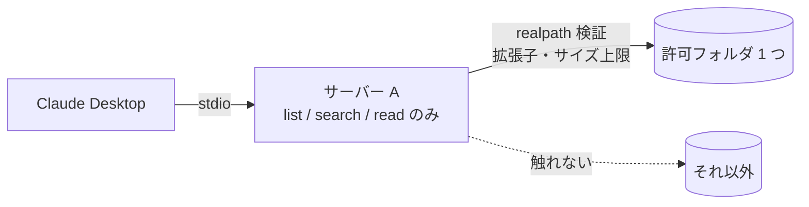
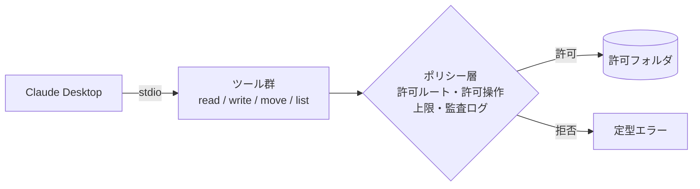
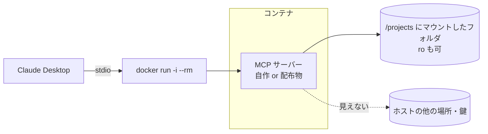
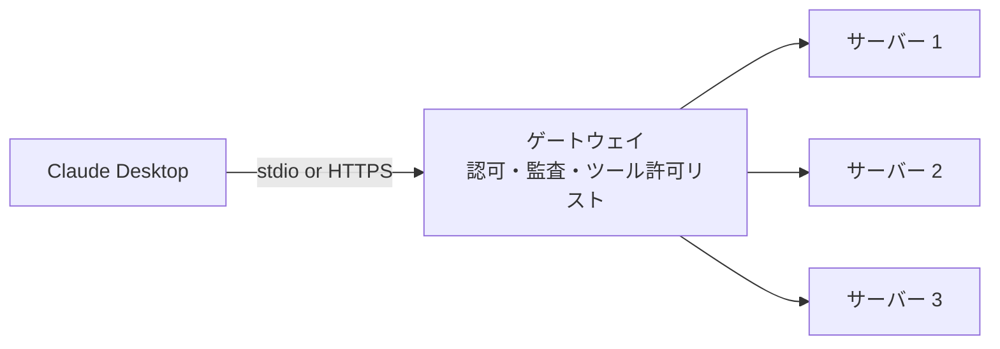

# 03. 改良案の比較(A〜D)

[01](01-threat-model.md) の脅威 T1〜T10 に対して、現実的な 4 つの作り方を比較します。
どれも「Claude Desktop にローカル MCP サーバーとして入れる」ことを前提にし、設定例は公式ドキュメントで確認できる形式だけを使います
(`mcpServers` / `command` / `args` / `env`。参考資料 [D1])。

## 案 A: 最小権限の単機能サーバー(読み取り専用・許可リスト)

目的を 1 つに絞り(例: 指定フォルダのメモ検索)、**書き込み系ツールを一切持たない**サーバーを、
許可ルート・拡張子・サイズ・件数の許可リストと上限で固める。



| 観点 | 内容 |
|---|---|
| 守れる脅威 | T1(実害化を防ぐ: 壊すツールがない)、T2、T3、T4(秘密を持たない)、T8、T9、T10 |
| 弱い脅威 | T5(自作なら出所は明確だが、依存の `mcp` SDK 等は残る)、T6/T7(説明文は自分で管理できる。出力の指示混入は「データである」明示と量の制限で緩和するのみ) |
| 導入コスト | 低。数百行。テストしやすい(純粋関数中心) |
| 向く場面 | 個人・小規模チームで「このフォルダを Claude に読ませたい」「この API を参照させたい」 |
| 向かない場面 | 書き込みが要件に含まれる場合(その場合も「書く先」を別サーバーに分けるのが案 A の延長) |

設定例(自作サーバーをローカルのプロジェクトから起動。`uv` は公式チュートリアルが示す起動方法 [D2]):

```json
{
  "mcpServers": {
    "notes": {
      "command": "/絶対パス/uv",
      "args": ["--directory", "/絶対パス/secure-mcp-server-guide", "run", "reference/server.py"],
      "env": { "NOTES_ROOT": "/絶対パス/読ませてよいフォルダ" }
    }
  }
}
```

## 案 B: 汎用サーバー + サーバー内ポリシー層

ファイル操作全般(読み書き・一覧・移動)を提供しつつ、**すべてのツールが共通の「ポリシー層」を通る**ようにする。
ポリシー層で許可ルート、許可操作、拒否パターン、レート制限、監査ログを一括管理する。



| 観点 | 内容 |
|---|---|
| 守れる脅威 | T2、T3、T8、T9、T10(ポリシー層が正しければ) |
| 弱い脅威 | **T1/T7**: 書き込みツールがある以上、承認を人が誤れば実害が出る。ポリシーは「どこに書くか」は制限できても「書くべきか」は判断できない。T6 は自作なら問題なし |
| 導入コスト | 中。ポリシー層の網羅性(新しいツールを足したときに通し忘れない構造)が品質を決める |
| 向く場面 | 「読むだけでは足りない」が、対象フォルダは限定できる個人用途 |
| 向かない場面 | 複数人で共有する環境(一人の誤承認が共有データに及ぶ) |

設定例は案 A と同じ形。違いはサーバー側の作り。

## 案 C: コンテナ(サンドボックス)内で起動

サーバーをコンテナで動かし、**ホスト側の見せたいフォルダだけをマウントする**(読み取り専用マウントも可)。
Claude Desktop からは `docker run -i --rm ...` を `command`/`args` として起動する。
公式の filesystem サーバーの README がこの形式の設定例を載せている(参考資料 [S5])。



| 観点 | 内容 |
|---|---|
| 守れる脅威 | **T2、T3、T5 に強い**(サーバーのコードが悪意を持っていても、見えるのはマウントした範囲)。T4 も「ホストの秘密が見えない」点で有利 |
| 弱い脅威 | T1/T6/T7 は変わらない(マウント内の書き込みや、出力経由の指示は防げない)。T8 はコンテナ内のログ設計次第。ネットワークを切らない限り外部送信は可能 |
| 導入コスト | 中〜高。コンテナランタイムの導入と起動時間、Windows/macOS でのパス指定、環境変数の受け渡しが手間 |
| 向く場面 | **出所を完全には信用できない配布サーバーを使いたい**とき。チームで同じ環境を配りたいとき |
| 向かない場面 | 非エンジニアの PC に入れる、起動の軽さが重要 |

設定例の形(具体的なイメージ名・マウント先は公式 README の例に倣う [S5]):

```json
{
  "mcpServers": {
    "files-sandboxed": {
      "command": "docker",
      "args": [
        "run", "-i", "--rm",
        "--mount", "type=bind,src=/絶対パス/読ませてよいフォルダ,dst=/projects/notes,ro",
        "mcp/filesystem", "/projects"
      ]
    }
  }
}
```

## 案 D: 外部ゲートウェイ(プロキシ)で集中制御

Claude Desktop には**ゲートウェイ 1 つだけ**を登録し、ゲートウェイが背後の複数サーバーへ中継する。
認可・監査ログ・ツールの許可リスト・レート制限をゲートウェイで集中管理する。
ゲートウェイ自体はローカル(stdio)でも、組織内のリモート(Streamable HTTP + 認証)でもよい。



| 観点 | 内容 |
|---|---|
| 守れる脅威 | 組織的な T2(誰がどのツールを使えるか)、T8(監査ログの集約)、T5(承認済みサーバーだけ中継) |
| 弱い脅威 | **T1/T6/T7 は中継しても消えない**。ゲートウェイ自体が新たな単一障害点・高権限点になる(T2 の再発)。背後サーバーの T3 はゲートウェイでは直せない |
| 導入コスト | 高。運用する人が必要。個人では過剰 |
| 向く場面 | 部署以上の規模で、多数のサーバーを配布・統制したい |
| 向かない場面 | 個人〜数人。守りたいものが 1 フォルダ程度 |

設定例の形(リモートの場合、Claude では「カスタムコネクタ」として URL を追加する方式もある。参考資料 [C2][D4]):

```json
{
  "mcpServers": {
    "gateway": {
      "command": "/絶対パス/gateway-binary",
      "args": ["--config", "/絶対パス/gateway.yaml"]
    }
  }
}
```

## 比較表

凡例: ◎ 根本的に防ぐ / ○ 大きく緩和 / △ 一部 / × 効果なし

| 脅威 | A 単機能・読み取り専用 | B 汎用+ポリシー層 | C コンテナ | D ゲートウェイ |
|---|---|---|---|---|
| T1 プロンプトインジェクション経由のツール悪用 | ◎(壊すツールがない) | △(承認頼み) | △ | △ |
| T2 過剰な権限 | ◎ | ○ | ◎ | ○(組織的) |
| T3 パストラバーサル | ◎(検証+テスト) | ○ | ◎(見えない) | × |
| T4 秘密情報の漏えい | ○(秘密を持たない) | △ | ○ | △ |
| T5 サプライチェーン | △(自作+ロック) | △ | ◎ | ○ |
| T6 ツール説明文の毒入れ | ○(自分で書く) | ○ | × | △(許可リスト) |
| T7 出力に混ざった指示 | ○(明示+上限) | △ | × | △ |
| T8 過剰なログ | ◎(設計で決める) | ○ | △ | ○(集約) |
| T9 リソース枯渇 | ◎ | ○ | △ | ○ |
| T10 stdout 汚染 | ◎ | ◎ | ◎ | ◎ |
| 導入コスト | 低 | 中 | 中〜高 | 高 |
| 向く規模 | 個人〜小規模 | 個人 | 個人〜チーム | 部署以上 |

## 組み合わせについて

A〜D は排他ではありません。現実的な組み合わせは次の 2 つです。

- **A 単体**(本資料の推奨。次章)
- **A をコンテナ(C)で包む**: 自作サーバーでも、依存パッケージの信頼度に不安があるとき。起動の手間と引き換えに T5 を強化できる

B と D は「読み取りだけでは要件を満たさない」「複数人に配る」という要件が出てから検討するのが順序としてよい、というのが本資料の立場です。
