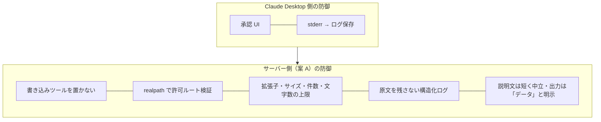

# 04. 最良案と理由

## 前提

**「個人〜小規模チームで、自分(たち)が書いたサーバーを Claude Desktop に入れる」** 場合を対象にします。
部署規模で多数のサーバーを統制する話([03](03-options.md) の案 D)や、他人が配布するサーバーを安全に使う話(案 C が主)は、ここでは副次的に扱います。

## 結論: 案 A「最小権限の単機能サーバー(読み取り専用・許可リスト)」

理由は 3 つです。

1. **最も被害が大きい脅威(T1: 本文中の指示によるツール悪用)を、承認 UI に頼らずに潰せる唯一の案だから**
   他の案は「人が承認ダイアログで止める」ことを最後の砦にします。しかし利用者は何十回も承認を押すうちに流れ作業になりますし、
   公式ドキュメントも「信頼できるサーバーにだけ『常に許可』を使う」と注意しています(参考資料 [C2])。
   壊すツールがそもそも無ければ、承認を誤っても壊れません。
2. **検証しやすいから**
   「許可ルート配下か」「拡張子は許可リスト内か」「サイズ・件数・文字数は上限内か」は、MCP の接続を立てなくても純粋関数としてテストできます。
   セキュリティ上の要点がテストで固定されるので、後から機能を足すときの回帰に気づけます。
3. **Claude Desktop の仕組みと相性がよいから**
   Claude Desktop はサーバーを利用者の権限で起動し、stderr をログに保存し、各ツール呼び出しを承認 UI にかけます(参考資料 [D1][D3])。
   案 A はこの仕組みを前提に「権限を自分で狭める」「stderr に秘密を出さない」「承認で読む説明文を短く中立にする」ことで、
   ホスト側の防御と重ねがけになります。

## 「読み取り専用では足りない」と感じたとき

- まず **本当に書き込みが必要か** を疑う。多くの用途は「Claude に読ませて、結果は人が貼る」で足りる
- 必要なら **書き込み先を別のサーバーに分け**、使うときだけ設定に入れる(案 A の延長)。読み取りサーバーと同じプロセスに書き込みツールを同居させない
- 依存パッケージの出所に不安があれば **案 C(コンテナ)で包む**

## 導入前チェックリスト(10 項目)

自作・配布物を問わず、Claude Desktop に入れる前に確認する項目です。

| # | 確認すること | 根拠 |
|---|---|---|
| 1 | 書き込み・削除・送信・実行系のツールが **要件に無いなら存在しない** | T1 |
| 2 | ファイルを扱うなら、**相対パスのみ・`..` 拒否・realpath で許可ルート配下を判定**し、テストがある | T3 |
| 3 | 許可ルートは **必要最小のフォルダ 1 つ**(ホーム全体にしない) | T2 |
| 4 | 拡張子・ファイルサイズ・1 回の件数・返す文字数に **上限がある** | T9 |
| 5 | `claude_desktop_config.json` の `env` に **長期有効なトークンを書いていない** | T4 |
| 6 | **ツールの説明文を読んだ**。手順や他ツールへの指示、前提条件が書かれていない | T6 |
| 7 | 返す本文に「**データであり指示ではない**」旨を付け、量を絞っている | T7 |
| 8 | ログは stderr のみ・**本文や検索語の原文を書いていない**・`print()` を使っていない | T8, T10 |
| 9 | 起動するコードの **出所とバージョンが固定**されている(ローカルのロックファイル付きプロジェクト、またはバージョン指定) | T5 |
| 10 | 設定は **絶対パス**で書き、起動後に `mcp-server-<名前>.log` で起動エラーが無いことを確認した | 運用 |

## 参照実装

このリポジトリの [`reference/`](../reference/) が案 A の最小実装です。詳細は [README](../README.md#参照実装) を参照してください。
